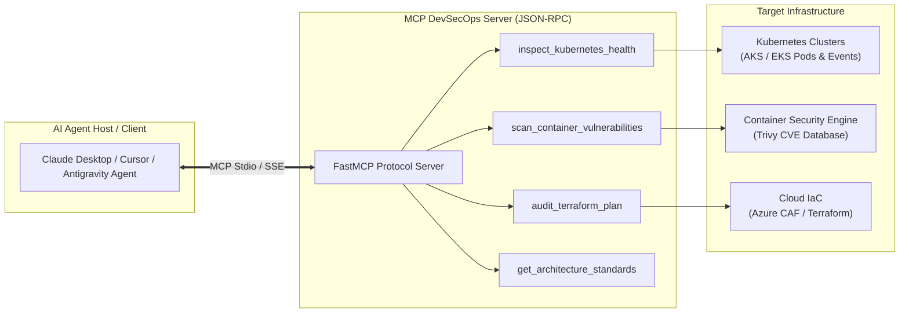

# 🤖 Model Context Protocol (MCP) DevSecOps Agent

[](#)
[](#)
[](#)
[](#)

> **Enterprise Model Context Protocol (MCP) server & autonomous agent system** engineered to empower AI agents with real-time Kubernetes cluster introspection, container vulnerability scanning, Policy-as-Code linting, and automated incident triage.

---

## 🏛️ Architecture: Agentic DevSecOps Fabric



---

## 🛠️ MCP Tools & Resources Exposed

| Name | Type | Description |
| :--- | :--- | :--- |
| `scan_container_vulnerabilities` | **Tool** | Scans container images for CVEs, classifies severity, and asserts compliance policies |
| `inspect_kubernetes_health` | **Tool** | Queries live pod states, OOMKilled events, restart counts, and generates remediation recommendations |
| `audit_terraform_plan` | **Tool** | Audits Terraform plan configurations against CIS benchmarks and network security policies |
| `devops://architecture/standards` | **Resource** | Exposes zero-trust Azure CAF landing zone and Kubernetes hardening standards directly into LLM context |

---

## 🚀 Quickstart & Setup

### 1. Installation
```bash
git clone https://github.com/Ashu02412/mcp-devops-agent.git
cd mcp-devops-agent
python -m venv .venv
source .venv/bin/activate  # On Windows: .venv\Scripts\activate
pip install -r requirements.txt
```

### 2. Configure with your AI IDE / Client (Claude, Cursor, Antigravity)
Add the following to your MCP client configuration (`mcp_config.json`):
```json
{
  "mcpServers": {
    "devops-security-agent": {
      "command": "python",
      "args": ["-m", "src.server"],
      "env": {
        "PYTHONPATH": "."
      }
    }
  }
}
```

### 3. Run Autonomous Triage Agent
```bash
python src/agent.py
```

---

## 👨💻 Author

**Ashu Dixit (Ashu02412)**  
*Senior DevSecOps & AI Platform Engineer*  
- GitHub: [@Ashu02412](https://github.com/Ashu02412)  
- Email: [ashu05.dixit@gmail.com](mailto:ashu05.dixit@gmail.com)
